  <h1>Hi, I'm Rizki Fadhillah 👋</h1>
  

    <strong>Full-Stack Web Developer &amp; Self-Hosted Infrastructure Builder</strong> from Indonesia 🇮🇩 
    Building scalable web apps, automated QRIS payment gateways, Linux/Docker hosting, and live streaming tools.
  

  

    
    
    
    
    
  

---

### 🚀 Live Self-Hosted Ecosystem (`rizkif.com`)

| Service | Domain | Description |
| :--- | :--- | :--- |
| **Portfolio & Hub** | [rizkif.com](https://rizkif.com/) | Personal website, GitHub sync, Sketchbook music island & live Spotify tracker |
| **Rizkif Hosting** | [hosting.rizkif.com](https://hosting.rizkif.com/) | Web Hosting (Nginx + PHP 8.3, WordPress, Laravel), Python/Node.js bots, Minecraft & Domains |
| **Rizkif Panel** | [panel.rizkif.com](https://panel.rizkif.com/) | Unified server control panel, live console, SFTP, MySQL & billing dashboard |
| **Rizkif Pay** | [payment.rizkif.com](https://payment.rizkif.com/) | Autonomous 0%-fee dynamic EMVCo QRIS payment gateway & merchant API |
| **Sawer Rizkif** | [sawer.rizkif.com](https://sawer.rizkif.com/) | Live streaming creator tipping with OBS Alert Box, Indonesian TTS & YouTube MediaShare |
| **Status Monitor** | [status.rizkif.com](https://status.rizkif.com/) | 24/7 real-time uptime & latency monitor across all services |

---

### 🛠 Tech Stack

  
   
  

---

### 🎧 Live Spotify Activity (Self-Hosted Realtime API)

  
   
  Powered by my own self-hosted Node.js Spotify API · <a href="https://rizkif.com/api/spotify/now">JSON Endpoint</a> · <a href="https://open.spotify.com/user/azu8otz4am42t2ys8mdiu5ma6">Spotify Profile</a>

---

### 📊 GitHub Analytics

  
  
   
  
   
  

 

  <picture>
    <source media="(prefers-color-scheme: dark)" srcset="https://raw.githubusercontent.com/rizkif-com/rizkif-com/pacman-output/galaga-contribution-graph-dark.svg?game=galaga">
    <source media="(prefers-color-scheme: light)" srcset="https://raw.githubusercontent.com/rizkif-com/rizkif-com/pacman-output/galaga-contribution-graph.svg?game=galaga">
    
  </picture>

